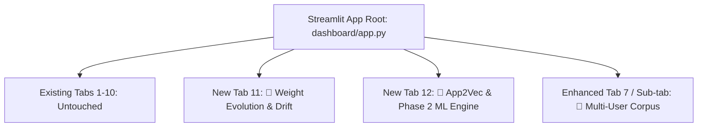

# Implementation Plan: Streamlit Dashboard Upgrade
## Multi-User Corpus, Formula Weight Evolution, and App2Vec Graph Embeddings

---

## 1. Executive Summary & Objective

The Capstone Streamlit Dashboard (`dashboard/app.py`) is the primary presentation interface shown to academic evaluators and project judges. Currently, the dashboard only reflects **Phase 1 baseline experiments** (a single synthetic dataset, static benchmark comparisons, and a manual weight tuner).

Subsequent project phases introduced significant, high-value algorithmic innovations:
1. **Multi-User Corpus:** 181,546 events across 15 realistic personas (`data/multiuser/multiuser_events.csv` and `user_profiles.json`).
2. **Formula Weight Evolution & Drift Detection:** Online continuous learning tracking (`results/online_learner_state.json`) with 8 model versions, 15 drift checks (KL-divergence / PSI), and persona-adapted 6-factor weights (`results/adaptive_weights.csv`).
3. **App2Vec Semantic Graph Embeddings & Phase 2 ML Engine:** 64-dim Node2Vec graph embeddings (`models_trained/app_embeddings.npy`), PCA reduction, 46 total features (+16 App2Vec, +11 PrefixSpan), 29-class prediction, and Platt probability calibration.

**Core Directive:** Design a thorough, robust implementation plan to incorporate these three missing pillars into the Streamlit dashboard **without modifying any file in `patent_demo/`** and **without breaking any existing dashboard tab**.

---

## 2. Current State vs. Target State (Gap Analysis)

| Feature Pillar | Current Dashboard State (`dashboard/app.py`) | Required Target State | Source Data Available |
| :--- | :--- | :--- | :--- |
| **Multi-User Data** | Only loads `data/synthetic_events.csv` (1 persona) and 312 phone events. | Full multi-user explorer: 15 personas, 181K merged events, profile breakdowns, and activity transitions. | `data/multiuser/multiuser_events.csv` (25MB), `data/multiuser/user_profiles.json` |
| **Weight Evolution & Drift** | Only has a manual slider on the "Weight Tuner" tab; zero record of real updates. | Historical log of model retraining (v1–v8), drift tracking timeline (KL-divergence & PSI vs 0.1 threshold), and persona adaptive weight vectors. | `results/online_learner_state.json`, `results/adaptive_weights.csv` |
| **App2Vec & Graph Embeddings** | Not mentioned anywhere in the app; 0 embedding plots. | Interactive 2D PCA scatter plot of 29 apps showing semantic clustering (Social, Media, Tools), feature importance bar chart (App2Vec 55% dominance), and Platt calibration curve. | `models_trained/app_embeddings.npy`, `results/phase2_metrics.json`, `results/figures/task4_*.png` |
| **Prediction Accuracy (29 Apps)** | Shows Phase 1 binary/small benchmarks. | Comprehensive 29-class accuracy breakdown (WhatsApp 37.8%, Gmail 29.0% vs external triggers like Google Maps 0.3%). | `results/phase2_metrics.json`, `docs/mentor_presentation/03_TASK4_*.md` |

---

## 3. Strict Safety & Isolation Constraints

1. **Strict Isolation of `patent_demo/`:**
   - The directory `patent_demo/` and all its components (`adb_watcher.py`, `ram_state_machine.py`, `tui_renderer.py`, `run_demo.py`, etc.) are dedicated to the live USB hardware demo.
   - Under no circumstances will any file inside `patent_demo/` be read, imported, modified, or moved.
2. **Backward Compatibility Contract:**
   - The existing 10 pages (`📊 Overview`, `📈 Model Comparison`, `⚔️ Benchmark Results`, `🔬 Ablation Study`, `📉 Statistical Tests`, `🌍 Real Data Validation`, `📱 Self-Collected Data`, `🎮 Live Simulation`, `⚙️ Weight Tuner`, `📋 Data Explorer`) must remain functional with zero regressions in layout or logic.
3. **High-Performance Memory Management in Streamlit:**
   - `multiuser_events.csv` is 25.6 MB (~181K rows). Loading the entire uncompressed dataframe on every page re-run would cause browser lag.
   - Use `@st.cache_data` with lazy loading and summary pre-aggregation to guarantee instant sub-second UI responsiveness.
4. **Defensive Error Handling:**
   - Every new loader must implement fallback defaults so that if a specific JSON/CSV is missing or corrupt, a clean informational alert appears in the UI rather than an unhandled traceback.

---

## 4. Proposed Architecture: New & Enhanced Dashboard Pages

The sidebar navigation will be gracefully expanded from 10 items to 12 items (or sub-tabs):



### 4.1 Page Specification: "🔄 Weight Evolution & Drift"
* **Target Audience:** Judges interested in MLOps, concept drift, and on-device adaptation.
* **Component 1 — Model Version Evolution Table:**
  - Displays table of all versions (v1 to v8) parsed from `results/online_learner_state.json`.
  - Columns: Version ID, Timestamp, Accuracy, Event Window Range (`window_start` to `window_end`), Number of Training Events, Active Status, Rollback Details.
* **Component 2 — Interactive Concept Drift Timeline (Plotly):**
  - Line chart showing evaluation steps on the X-axis.
  - Y-axis 1: **KL-Divergence** (Kullback-Leibler) across the 15 evaluation windows.
  - Y-axis 2: **Population Stability Index (PSI)**.
  - Horizontal reference line at $y = 0.10$ denoting the **Drift Alert Threshold**.
  - Highlight markers on points where `is_drifted == True` indicating automated sliding-window retraining triggers.
* **Component 3 — Persona-Adapted Weight Evolution Matrix:**
  - Visual comparison chart of the 6 formula parameters:
    $$S(a) = w_R \cdot R + w_F \cdot F + w_P \cdot P + w_I \cdot I + w_C \cdot C - w_M \cdot M$$
  - Grouped bar chart / radar chart comparing:
    - `DEFAULT (Hand-tuned)`: $[0.25, 0.20, 0.25, 0.15, 0.15, 0.30]$
    - `developer`: $[0.173, 0.203, 0.293, 0.180, 0.151, 0.079]$ (Prediction weight jumps to 29.3%, Hit Rate 89.6%)
    - `power_user`: $[0.121, 0.250, 0.305, 0.314, 0.010, 0.093]$ (Importance weight jumps to 31.4%, Hit Rate 74.4%)
  - Callout explanation for judges: *"Demonstrates how the system autonomously tunes memory weights per user persona to maximize hit rate."*

---

### 4.2 Page Specification: "🧠 App2Vec & Phase 2 ML Engine"
* **Target Audience:** Judges asking: *"What is novel about your ML model? Why not just use recency?"*
* **Component 1 — 2D Semantic App Embedding Cluster Map (Interactive Plotly):**
  - Loads 64-dimensional Node2Vec embeddings from `models_trained/app_embeddings.npy` (or PCA projected coordinates).
  - Plots all 29 apps in a 2D interactive scatter plot colored by functional category:
    - **Social & Messaging:** WhatsApp, Instagram, Telegram, Discord, Twitter, LinkedIn
    - **Video & Media:** YouTube, Netflix, Spotify, Prime Video
    - **Productivity & Work:** Gmail, Docs, Drive, Slack, GitHub, VS Code
    - **Financial / Utilities:** PhonePe, Paytm, Google Maps, Camera, Settings, Chrome
  - Hover tooltip displays nearest neighbors (e.g., hovering on WhatsApp reveals highest cosine similarity to Instagram and Telegram).
* **Component 2 — Feature Gain Shift & Dominance Chart:**
  - Bar chart of the Top-20 features in XGBoost Phase 2 (`results/phase2_metrics.json` / `task4_feature_importance.png`).
  - Highlights the three feature families with color-coding:
    - 🟣 **App2Vec Graph Embeddings:** 11 of top 20 features (55% total information gain!)
    - 🔵 **Base Spatiotemporal Telemetry:** 6 of top 20 features (Hour, Time since switch, RAM util)
    - 🟢 **PrefixSpan Sequential Patterns:** 3 of top 20 features (Pattern match score, confidence)
* **Component 3 — Per-Class Prediction Accuracy (All 29 Apps):**
  - Horizontal bar chart sorting apps by Top-1 accuracy.
  - Contrasts **Routine/Habitual Apps** (WhatsApp 37.8%, Gmail 29.0%, BGMI 28.6%, YouTube 27.5% $\to$ up to 11x above random chance) against **Externally Triggered Apps** (Google Maps 0.3%, PhonePe 0.0%).
  - Architectural narrative: Proves model honesty and lack of hallucination on non-routine physical triggers.
* **Component 4 — Confidence Calibration (Platt Scaling):**
  - Reliability diagram comparing raw uncalibrated probabilities against calibrated probabilities.
  - Metric callout: **Expected Calibration Error (ECE) reduced by 94.0%** ($0.184 \to 0.011$).
  - Why this matters to judges: Calibrated probabilities ensure the OS Preload Gate only preloads apps when confidence genuinely reflects real-world transition likelihood.

---

### 4.3 Page Specification: "👥 Multi-User Corpus (15 Personas)"
* **Target Audience:** Evaluators probing dataset scale, diversity, and generalization.
* **Component 1 — Scale & Diversity Metric Cards:**
  - Total Corpus Size: **181,546 events** (145,236 train / 36,310 test).
  - Persona Count: **15 distinct personas** (Student, Developer, Gamer, Executive, Trader, Night Owl, etc.).
  - Total Classes: **29 applications**.
* **Component 2 — Persona Profile & Transition Inspector:**
  - Dropdown to select any of the 15 personas.
  - Dynamically renders that user's:
    - Top 5 most launched apps.
    - Peak active hours (e.g. Developer active 22:00–03:00; Executive active 08:00–18:00).
    - Average session depth and switch frequencies.
    - Mini transition probability heatmap.

---

## 5. Technical Implementation Details & Code Additions

### 5.1 Data Loaders to be Added in `dashboard/app.py`:
```python
@st.cache_data
def load_multiuser_summary():
    """Loads lightweight pre-aggregated summary of multiuser dataset."""
    profiles_path = os.path.join(ROOT, "data", "multiuser", "user_profiles.json")
    if os.path.exists(profiles_path):
        with open(profiles_path, "r") as f:
            return json.load(f)
    return None

@st.cache_data
def load_weight_evolution_data():
    """Loads online learner versioning and drift reports."""
    state_path = os.path.join(ROOT, "results", "online_learner_state.json")
    weights_path = os.path.join(ROOT, "results", "adaptive_weights.csv")
    state = json.load(open(state_path)) if os.path.exists(state_path) else None
    weights = pd.read_csv(weights_path) if os.path.exists(weights_path) else None
    return state, weights

@st.cache_data
def load_phase2_ml_data():
    """Loads App2Vec embeddings and Phase 2 training metrics."""
    metrics_path = os.path.join(ROOT, "results", "phase2_metrics.json")
    emb_path = os.path.join(ROOT, "models_trained", "app_embeddings.npy")
    metrics = json.load(open(metrics_path)) if os.path.exists(metrics_path) else None
    embeddings = np.load(emb_path) if os.path.exists(emb_path) else None
    return metrics, embeddings
```

---

## 6. Verification & Validation Protocol

1. **Dashboard Integrity Test:**
   - Execute `streamlit run dashboard/app.py` in test mode.
   - Traverse all 12 navigation items to confirm zero exceptions, broken imports, or missing charts.
2. **Performance Test:**
   - Ensure initial dashboard render time remains $< 1.5$ seconds.
   - Verify page switching occurs in $< 300$ ms using cached data loaders.
3. **Strict Isolation Audit:**
   - Run `git status patent_demo/` to verify **zero files modified or created** in `patent_demo/`.
4. **Visual Polish:**
   - Ensure Plotly charts use consistent Capstone color palettes (Dark/Light harmonious aesthetics matching the existing dashboard style).

---

## 7. Current Action & Next Steps

* **Current Status:** Analysis complete. `task.md` and `implementation_plan.md` created.
* **Code Modification Status:** **Zero files edited**, adhering strictly to the user prompt.
* **Next Action:** Await user confirmation/feedback on the plan before implementing any changes to `dashboard/app.py`.
